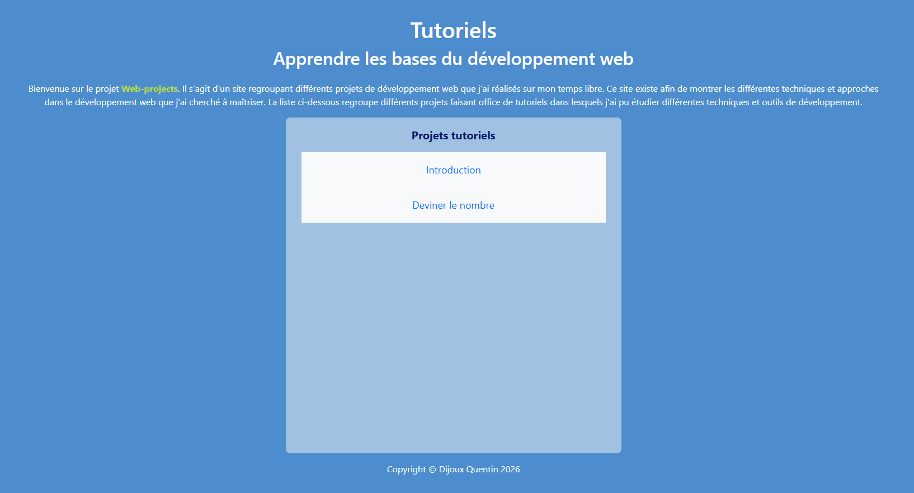
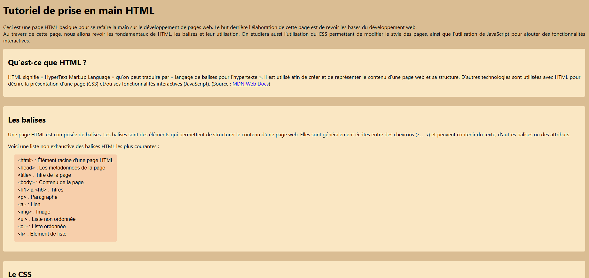
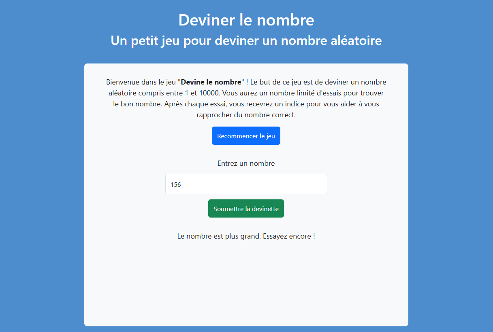

# Web-projects

## Présentation

Ce dépôt regroupe un ensemble de petits projets web réalisés dans un objectif pédagogique. L'objectif est de me permettre de reprendre progressivement en main le développement web, de revoir les fondamentaux et d'expérimenter différentes approches pour créer des pages interactives.

Chaque projet est volontairement indépendant et se concentre sur une ou plusieurs notions précises : structure HTML, mise en forme CSS, responsive design, interactions JavaScript et utilisation de frameworks comme Bootstrap.

## Projets

Le dossier [`Tuto_html`](./Tuto_html) contient actuellement les projets
suivants :

- **Tutoriels** ([`index.html`](./Tuto_html/index.html)) : page d'accueil et
  navigation entre les différents tutoriels.
- **Prise en main HTML** ([`prise_en_main.html`](./Tuto_html/prise_en_main.html)) :
  rappel des bases de HTML et de CSS, avec quelques interactions JavaScript.
- **Deviner le nombre** ([`nombre.html`](./Tuto_html/nombre.html)) : petit jeu
  JavaScript basé sur la génération d'un nombre aléatoire et la gestion des
  événements.

## Objectifs

- Revoir les bases du HTML, du CSS et du JavaScript.
- Reprendre de bonnes habitudes de structuration et d'accessibilité.
- Expérimenter la création d'interfaces simples et responsives.
- Tester des interactions utilisateur et la manipulation du DOM.
- Découvrir progressivement différents outils et frameworks web.

## Aperçu

### Page d'accueil



### Tutoriel de prise en main



### Jeu « Deviner le nombre »



## Structure du dépôt

```text
.
├── Tuto_html/
│   ├── index.html
│   ├── nombre.html
│   └── prise_en_main.html
└── ressources/
    └── img/
        ├── index_ui.png
        ├── numbers_ui.png
        └── tuto_ui.png
```

## Utilisation

Les pages peuvent être ouvertes directement dans un navigateur. Pour commencer, ouvrez [`Tuto_html/index.html`](./Tuto_html/index.html), puis utilisez les
liens de navigation pour accéder aux différents projets.
Ce dépôt est avant tout un espace d'apprentissage et d'expérimentation ; son contenu évoluera au fil des notions revues et des nouveaux projets ajoutés.
